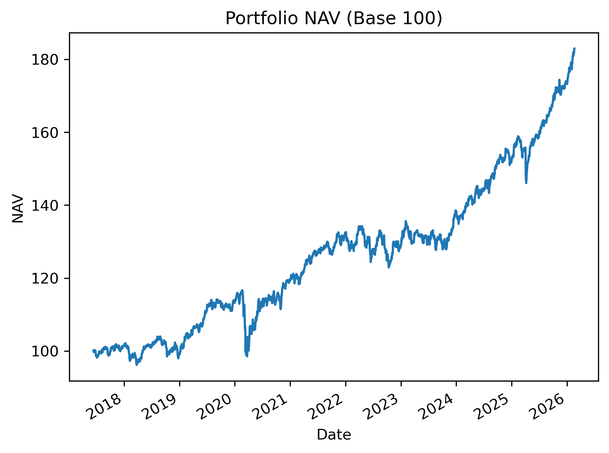
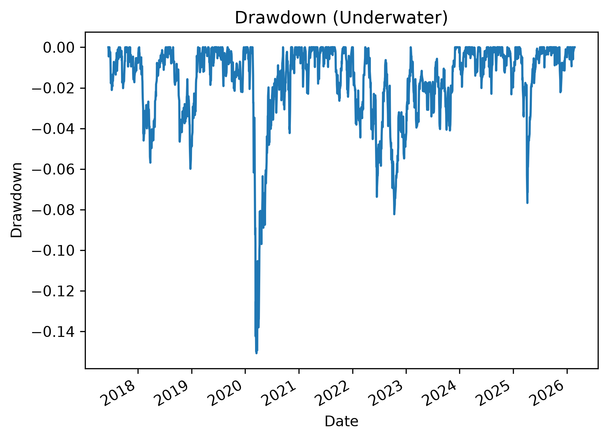

# Multi-Asset Portfolio Analysis

A reproducible Python backtest of a diversified nine-asset allocation, with quarterly rebalancing, explicit transaction costs and detailed performance, drawdown and tail-risk analytics.

## Research design

| Parameter | Implementation |
|---|---|
| Historical window | 2017–2026 |
| Assets | 9 ETF and index proxies |
| Rebalancing | Quarterly |
| Transaction costs | 5 bps on turnover |
| Starting NAV | 100 |
| Analytics | 20+ performance and risk metrics |

### Target allocation

| Sleeve | Weight |
|---|---:|
| MSCI World | 17.78% |
| World Quality Dividend | 8.89% |
| Europe equities | 11.11% |
| Asia-Pacific equities | 6.67% |
| Euro government bonds | 11.11% |
| US Treasuries | 11.11% |
| US inflation-linked bonds | 11.11% |
| Gold | 11.11% |
| US real estate | 11.11% |

## Latest backtest results

The nine-asset historical backtest covers 13 June 2017 to 23 February 2026 (the common available data window). Results reflect the current code with 5 bps of transaction costs applied to turnover at quarterly rebalancing.

| Metric | Result |
|---|---:|
| Final NAV (initial = 100) | 185.193 |
| Total return | +85.16% |
| CAGR | 7.34% |
| Annualised return (arithmetic mean) | 7.36% |
| Annualised volatility | 7.49% |
| Sharpe ratio (risk-free rate = 0) | 0.983 |
| Sortino ratio | 1.196 |
| Maximum drawdown | -15.08% |
| Calmar ratio | 0.487 |
| Daily VaR (95%) | -0.67% |
| Daily CVaR (95%) | -1.15% |

The annualisation uses approximately 245.91 observations per calendar year in the common-date sample. Values are rounded from the latest backtest run; the five headline metrics can be reproduced from `reports/tables/table_summary.csv`. These are historical backtest outputs, not forecasts. Data quality, cross-market closing times and implementation assumptions remain limitations.





## Pipeline

1. Download adjusted historical prices for the nine proxies.
2. Align the dataset to dates shared by every asset.
3. Calculate daily simple returns.
4. Apply target weights with quarterly rebalancing.
5. Deduct 5 bps from portfolio turnover.
6. Calculate performance, drawdown, distribution and tail-risk metrics.
7. Export charts and CSV tables to `reports/`.

## Reproduce the analysis

```bash
git clone https://github.com/KenaelMartini/multi-asset-portfolio-analysis.git
cd multi-asset-portfolio-analysis
python -m venv .venv
```

Activate the environment and install the minimal dependencies:

```bash
# Windows
.venv\Scripts\activate
python -m pip install pandas numpy matplotlib yfinance

# macOS / Linux
source .venv/bin/activate
python -m pip install pandas numpy matplotlib yfinance
```

Download the data and run the nine-asset backtest:

```bash
python scripts/download_data_kmco.py
python main_KMCO.py
```

## Repository structure

```text
data/                    Historical price matrices
scripts/                 Data-download scripts
src/                     Backtest engine, metrics and reporting modules
reports/figures/         Generated NAV, drawdown and return charts
reports/tables/          Generated summary and monthly-return tables
main_KMCO.py             Nine-asset portfolio analysis
main.py                  Simpler four-asset reference allocation
```

## Development approach

This project was developed through an AI-assisted workflow. I directed the allocation assumptions, rebalancing and cost methodology, iteratively evaluated and integrated generated code, and remained responsible for data validation, metric verification, interpretation and final outputs.

## Limitations

- The universe uses tradable proxies and does not model every implementation constraint.
- Results are sensitive to the common-history window, data source and rebalancing assumptions.
- Taxes, bid-ask spreads, market impact and currency-hedging costs are not fully modelled.
- Historical performance does not predict future results.

## Disclaimer

For educational and independent research purposes only. Nothing in this repository constitutes financial advice, an investment recommendation or a regulated financial service.